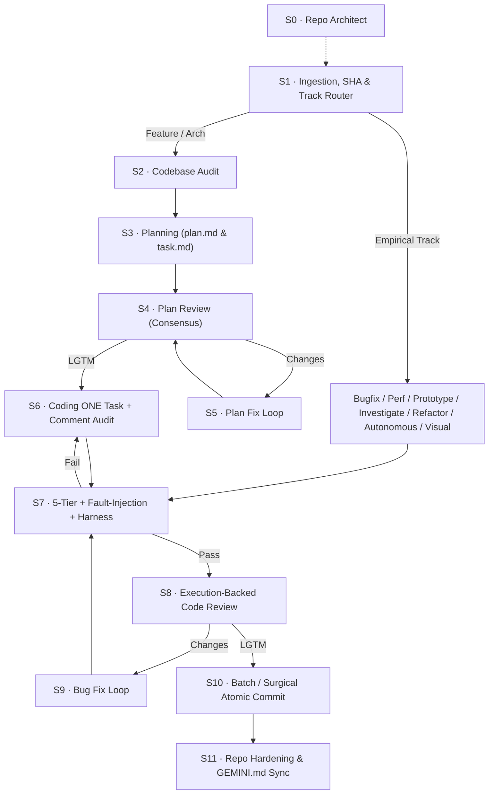

# Ideal Agentic Workflow — Invocation Guide (v2.0.0)

Use the template prompt below to trigger `ideal-agentic-workflow` in any chat session (or let `hooks.json` `SessionStart` + `rules/AGENTS.md` auto-dispatch `skills/s1-orchestrator/SKILL.md`). For read-only track help without mutating files, invoke `skills/workflow-guide/SKILL.md`.

---

## Copyable Workflow Invocation Prompt

```markdown
# INVOKE: ideal-agentic-workflow (v2.0.0)

## 1. Operating Mode / Task Track (Select one; defaults cleanly via S1)
- [x] **Standard** — Full S1–S11 lifecycle (`Option A` S3–S4 plan & review gates for features/migrations).
- [ ] **/bugfix** — Live repro & runtime/trace forensics -> minimal evidence-backed fix (`skills/s1-orchestrator/resources/tracks/bugfix-mode.md`).
- [ ] **/perf /hillclimb** — Frozen harness baseline -> single-hypothesis mantra optimization + `skills/benchmark-audit/SKILL.md` (`skills/s1-orchestrator/resources/tracks/perf-hillclimb-mode.md`).
- [ ] **/prototype** — Isolated scratch variants behind a switcher (`skills/s1-orchestrator/resources/tracks/prototype-mode.md`).
- [ ] **/investigate** — Read-only cited explanation or git-history tradeoff matrix (`skills/s1-orchestrator/resources/tracks/investigation-mode.md`).
- [ ] **/refactor** — Behavior-pinned structural simplification (`skills/s1-orchestrator/resources/tracks/refactor-mode.md`).
- [ ] **/autonomous /goal** — Predicate-locked loop with `commands/log-decision.ps1` (`skills/s1-orchestrator/resources/tracks/autonomous-mode.md`).
- [ ] **/visual-parity** — Baseline screenshot-diff visual migration (`skills/s1-orchestrator/resources/tracks/visual-parity.md`).
- [ ] **/fast mode** — Single-task (<= 3 files, 100 LOC), 1 reviewer, audit bypass.
- [ ] **/trivial** — Docs/non-source changes only. Skips audit, review, and tests.
- [ ] **/duolithic mode** — Heavy review offloaded to parallel R-Agent conversation.

## 2. Task Description
<!-- Describe your goal and checkable pass/fail verification criteria here -->
[INSERT TASK DESCRIPTION HERE]

## 3. Skip List (Optional overrides)
- [ ] **S0 — Repo Architect** (Skip if `GEMINI.md` is already certified)
- [ ] **S2 — Codebase Audit** (Skip if `audit.md` exists and is <= 7 days old)
- [ ] **S4 — Plan Review** (Allowed only on fast/empirical single-unit tracks)
- [ ] **S8 — Code Review** (Skip only if mode is `/trivial` or read-only `/investigate`)

*Fill in steps to skip this session:* None

## 4. Execution Lifecycle (S0–S11 & Empirical Tracks)



### Step-by-Step Directives & Cited Plugin Assets

- **S0 · Repo Architect** (`skills/s0-repo-architect/SKILL.md`):
  - Schemas & Templates: `skills/s0-repo-architect/schemas/gemini-prd-schema.json`, `skills/s0-repo-architect/schemas/anti-pattern-schema.json`, `skills/s0-repo-architect/templates/gemini-production-template.md`, `skills/s0-repo-architect/templates/directory-tree-explainer-template.txt`, `resources/gemini-template.md`.
  - Generators & Verification: `skills/s0-repo-architect/scripts/generate-ascii-tree.js`, `skills/s0-repo-architect/scripts/verify-gemini-schema.js`, plus project harness bootstrapping via `skills/verify-harness-generator/SKILL.md` (`skills/verify-harness-generator/references/feature-map-example/README.md`, `skills/verify-harness-generator/references/feature-map-example/create-note.md`, `skills/verify-harness-generator/references/feature-map-example/search.md`) and `skills/formal-verify-generator/SKILL.md`.
- **S1 · Ingestion, Track Routing & Help** (`skills/s1-orchestrator/SKILL.md`, `skills/workflow-guide/SKILL.md`, `skills/prompt-sharpen/SKILL.md`, `skills/context-recall/SKILL.md`):
  - Core Charters: `GEMINI.md`, `rules/AGENTS.md`, `resources/engineering-principles.md`, `skills/s1-orchestrator/resources/session-init.md`, `resources/checklist-template.md`, `resources/stacks/_stack-composer.md`.
  - Track & Mode Playbooks: `skills/s1-orchestrator/resources/fast-mode.md`, `skills/s1-orchestrator/resources/trivial-mode.md`, `skills/s1-orchestrator/resources/duolithic-mode.md`, `skills/s1-orchestrator/resources/tracks/bugfix-mode.md`, `skills/s1-orchestrator/resources/tracks/perf-hillclimb-mode.md`, `skills/s1-orchestrator/resources/tracks/prototype-mode.md`, `skills/s1-orchestrator/resources/tracks/investigation-mode.md`, `skills/s1-orchestrator/resources/tracks/refactor-mode.md`, `skills/s1-orchestrator/resources/tracks/autonomous-mode.md`, `skills/s1-orchestrator/resources/tracks/visual-parity.md`.
  - Command: `powershell|pwsh -File commands/init-session.ps1`.
- **S2 · Codebase Audit** (`skills/s2-codebase-audit/SKILL.md`):
  - Guides: `resources/audit-template.md`, `skills/s2-codebase-audit/resources/audit-compiler.md`, `skills/s2-codebase-audit/resources/fullstack-persona-bank.md`, `skills/s2-codebase-audit/resources/minecraft-persona-bank.md`.
  - Auditors: `agents/fullstack-architecture-auditor.md`, `agents/fullstack-security-reviewer.md`, `agents/fullstack-performance-seo-auditor.md`, `agents/fullstack-uiux-cro-auditor.md`, `agents/fullstack-test-quality-auditor.md`, `agents/postgres-hibernate-flyway-auditor.md`, `agents/mc-game-performance-auditor.md`, `agents/mc-mapping-compliance-auditor.md`, `agents/mc-mod-compatibility-auditor.md`, `agents/audit-compiler.md`.
- **S3 · Planning & Design Exploration** (`skills/s3-planning/SKILL.md`):
  - Schemas & Design Primitives: `resources/plan-template.md`, `resources/task-template.md`, `skills/s3-planning/resources/priority-rubric.md`, `skills/design-architect/SKILL.md`, `skills/solution-arena/SKILL.md`, `skills/blast-radius/SKILL.md`, `agents/arena-cross-judge.md`, `agents/empirical-worker.md`.
- **S4 / S5 · Plan Review & Fix Loop** (`skills/s4-plan-review/SKILL.md`, `skills/s5-plan-fix/SKILL.md`):
  - `agents/plan-critic.md`, `skills/s4-plan-review/resources/plan-review-guide.md`, `resources/submit-template.md`, `resources/review-template.md`.
- **S6 · Coding ONE Task & Comment Hygiene** (`skills/s6-coding/SKILL.md`, `skills/comment-audit/SKILL.md`, `agents/comment-hygiene-reviewer.md`):
  - Standards & Stack Rules: `rules/AGENTS.md`, `resources/senior-dev-standards.md`, `resources/error-handling-guide.md`, `resources/test-driven-development-guide.md`, `skills/s6-coding/resources/stack-detector.md`, `skills/s6-coding/resources/anti-patterns.md`.
  - Stack Packs & Rules: Matched ONLY for detected stacks from `resources/stacks/*.md` (including optional `resources/stacks/discord-bot-customizer.md`) + `resources/stack-rules/rules-*.md` (including `resources/stack-rules/rules-discord-bot-customizer.md`).
  - Scope Jail & Iteration Log: `commands/verify-scope.ps1`, `commands/escalate-scope.ps1`, `skills/decision-log/SKILL.md`, `skills/decision-log/references/decision-log-template.tsv`, `commands/log-decision.ps1`.
- **S7 · 5-Tier Verification, Fault Injection, Harness & Formal Model Checking** (`skills/s7-testing/SKILL.md`, `skills/benchmark-audit/SKILL.md`, `skills/verify-harness-maintainer/SKILL.md`, `skills/statechart/SKILL.md`, `skills/statechart/references/render.md`, `skills/statechart/scripts/statechart.ts`, `skills/formal-verify-maintainer/SKILL.md`):
  - Runners: `powershell|pwsh -File commands/verify-stack.ps1 -Target <DomainClass>`, `powershell|pwsh -File commands/check-ui-slop.ps1`, `powershell|pwsh -File commands/invoke-statechart.ps1 -SpecPath <file.tla>`, `powershell|pwsh -File commands/verify-scope.ps1`.
  - Scanners & Test Commands: `skills/s7-testing/resources/test-commands.md`, `scripts/check-layout-ast.mjs`, `scripts/check-gesture-parity.mjs`, `scripts/check-route-integrity.mjs`, `scripts/verify-runtime-env.mjs`, `resources/smoke-templates/*`.
- **S8 / S9 · Execution-Backed Code Review & Bug Fix** (`skills/s8-code-review/SKILL.md`, `skills/adversarial-review/SKILL.md`, `agents/adversarial-falsifier-reviewer.md`, `skills/s9-bug-fix/SKILL.md`):
  - `skills/s8-code-review/resources/task-reviewer-matrix.md`, `skills/s8-code-review/resources/code-review-guide.md`, `agents/fullstack-implementation-reviewer.md`, `agents/*-reviewer.md`.
- **S10 · Batch Auto-Commit & Manual Surgical Commit** (`skills/s10-git-commit/SKILL.md`):
  - Guides: `skills/s10-git-commit/resources/commit-examples.md`, `skills/s10-git-commit/resources/breaking-change-guide.md`, `skills/s10-git-commit/resources/commit-split-guide.md`.
  - Commands: `powershell|pwsh -File commands/auto-commit.ps1 [-DryRun]`, `commands/measure-diff.ps1`, `commands/stage-commit.ps1`.
- **S11 · Repo Hardening, Reflection & GEMINI.md Sync** (`skills/s11-gemini-update/SKILL.md`, `skills/repo-hardening/SKILL.md`, `skills/session-reflect/SKILL.md`, `skills/workflow-eval/SKILL.md`, `skills/session-catchup/SKILL.md`, `skills/plain-summary/SKILL.md`, `skills/prose-polish/SKILL.md`):
  - Schema & Cleanup: `skills/s11-gemini-update/resources/gemini-schema.md`, `resources/gemini-template.md`, `skills/s11-gemini-update/resources/global-skill-suggester.md`, `commands/clean-session.ps1`.

## 5. Non-Negotiable Invariants
1. **Turn-1 & Phase Read Gate (`AP-009`)**: Read `GEMINI.md` + `rules/AGENTS.md` + detected `resources/stack-rules/` BEFORE opening source files.
2. **Zero Self-Review (`AP-010`)**: Never author `.agents/session-[SHA]/code-review/review/*` or `audit/bin/*` from the main orchestrator.
3. **Strict Structural Laws**: `1 OOP type per file`, `<= 1` primary component + `<= 2 inline JSX children` per `.tsx`, zero `AP-001..AP-010`.
4. **Proof Over Claims (`EP-01`, `EP-06`, `EP-12`)**: Reproduce bugs live first, verify test assertions fail under fault injection, drop unproven review claims, and fix repeat mistakes in code/lints before docs.
5. **No `git push`, No `git add .` (`AP-005`)**: Always stage explicitly or use `commands/auto-commit.ps1`; preserve `PascalCase`/`camelCase` identifiers inside Conventional Commits (`<= 100` subject / `<= 180` body).

---
**Directive**: Acknowledge mode/track and active stack, initialize `.agents/session-[SHA]/`, and begin S1.
```

---

## Mode & Track Cheat Sheet

| Mode / Track | Trigger Keyword | Best For |
| :--- | :--- | :--- |
| **Standard Mode** | *(default)* | Features, DB migrations, cross-boundary architecture (`S2 -> S11`) |
| **Bugfix Track** | `/bugfix` | Live reproduction, runtime/trace forensics, minimal fix |
| **Perf / Hillclimb Track** | `/perf`, `/hillclimb` | Frozen benchmark harness, single-hypothesis tuning + `decision.tsv` |
| **Prototype Track** | `/prototype` | Throwaway isolated UX/API exploration behind variant switchers |
| **Investigation Track** | `/investigate` | Read-only cited explanation or git-history tradeoff table |
| **Refactor Track** | `/refactor` | Contract-pinned behavior-preserving cleanup |
| **Autonomous Track** | `/autonomous`, `/goal` | Predicate-locked unattended loops with `decision.tsv` |
| **Visual Parity Track** | `/visual-parity` | Baseline screenshot-diff UI migration |
| **Fast / Trivial / Duolithic** | `/fast mode`, `/trivial`, `/duolithic mode` | Single tiny patch / docs-only / R-Agent offload |

---

## Automation Commands (`powershell` or `pwsh`)

- `powershell|pwsh -File commands/init-session.ps1`: Scaffolds `.agents/session-[SHA]/`.
- `powershell|pwsh -File commands/auto-commit.ps1 [-DryRun]`: Clustered batch auto-commits (`scripts/auto-commit.mjs`).
- `powershell|pwsh -File commands/invoke-statechart.ps1 -SpecPath <file.tla>`: Runs formal TLA+ statechart verification (`skills/statechart/scripts/statechart.ts`).
- `powershell|pwsh -File commands/log-decision.ps1 -SessionDir <dir> -Decision ... -Action keep|revert|edit|note -Evidence ...`: Writes formula-safe TSV logs.
- `powershell|pwsh -File commands/measure-diff.ps1`: Checks diff size against `150` LOC threshold.
- `powershell|pwsh -File commands/verify-stack.ps1 -Target <Class>`: Runs 5-Tier verification.
- `powershell|pwsh -File commands/check-ui-slop.ps1`: Scans UI files for slop/debug buttons.
- `powershell|pwsh -File commands/escalate-scope.ps1`: Whitelists ancestor layout files in `task.md`.
- `powershell|pwsh -File commands/verify-scope.ps1`: Asserts modified files against declared task targets.
- `powershell|pwsh -File commands/stage-commit.ps1`: Manual single surgical Conventional Commit validator.
- `powershell|pwsh -File commands/clean-session.ps1`: Archives completed `.agents/session-[SHA]/`.
