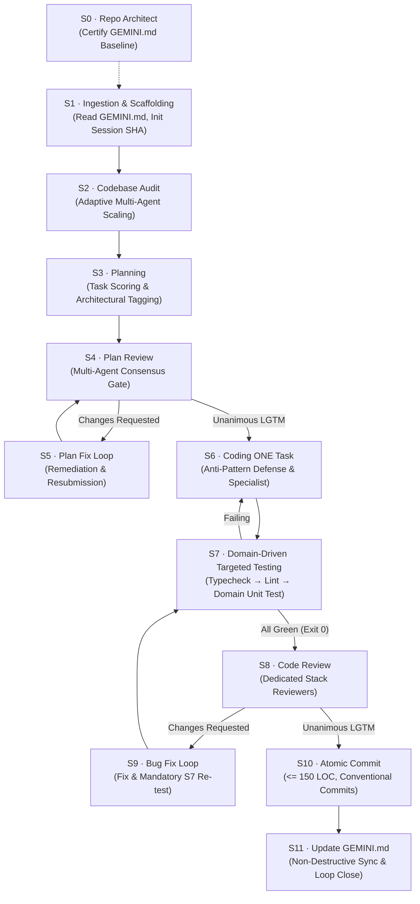
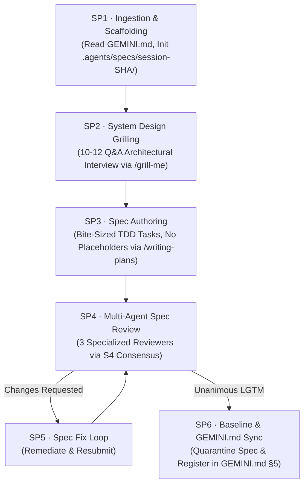

# ideal-agentic-workflow

<div align="center">

[](plugin.json)
[](https://github.com/RachitSWE)
[](https://antigravity.google)
[](scripts/verify-file-citations.js)
[](LICENSE.md)

**Enterprise-grade agentic engineering plugin for Google Antigravity.**  
*Eliminates "vibe coding" with deterministic multi-agent auditing, domain-driven testing, consensus review gates, atomic Conventional Commits, and automated specification pipelines.*

---

[Key Capabilities](#-key-capabilities) •
[S0–S11 Implementation Pipeline](#-s0s11-implementation-pipeline) •
[SP1–SP6 Spec Pipeline](#-sp1sp6-spec-architecture-pipeline) •
[Operating Modes](#-operating-modes) •
[Subagent Ecosystem](#-subagent-ecosystem-38-agents) •
[Stack Packs & Rules](#-technology-stack-packs--rules) •
[Automation Commands](#-automation-commands) •
[Verification Suite](#-verification--quality-suite) •
[License](#-license)

</div>

---

## ⚡ Key Capabilities

- **Dual Autonomous Pipelines**:
  - **S0–S11 Implementation Pipeline**: Full end-to-end software development lifecycle from repository discovery to monotonic `GEMINI.md` synchronization.
  - **SP1–SP6 Spec Architecture Pipeline**: Autonomous feature specification engine featuring interactive system design grilling (`/grill-me`), bite-sized TDD plans (`/writing-plans`), and multi-agent peer review (`S4`).
- **Scope Jail Enforcement**:
  - Eliminates "vibe wandering" and runaway edits by strictly confining modifications to paths declared in `task.md`. Ancestor layout expansions are audited via [`commands/escalate-scope.ps1`](commands/escalate-scope.ps1) and mechanically gated pre-review via [`commands/verify-scope.ps1`](commands/verify-scope.ps1).
- **5-Tier Mechanical Verification & Aesthetic Hardening**:
  - Revokes "aesthetic immunity" in code reviews. AST linters, UI slop detection ([`commands/check-ui-slop.ps1`](commands/check-ui-slop.ps1)), and headless smoke gates ([`resources/smoke-templates/`](resources/smoke-templates/)) mechanically enforce viewport clamping, 1:1 avatars, 10px gesture thresholds, and image buffer entropy (> 50KB, std-dev > 15.0).
- **Domain-Driven Targeted Testing (DTT)**:
  - Accelerates inner-loop feature iterations by executing domain-filtered unit and slice tests (`mvn test -Dtest=...`, `vitest path`, etc.) rather than running hundreds of tests on every single commit. Full suite verification is strictly gated at S10 pre-commit.
- **38 Subagent Definitions**:
  - Full matrix of S2 auditors, S6 framework specialists, S8 code reviewers, SP4 spec reviewers, plus `arena-cross-judge`, `empirical-worker`, `adversarial-falsifier-reviewer`, and `comment-hygiene-reviewer`.
- **Option A Unified Router + Empirical Tracks (`S1` + `SessionStart` Hook)**:
  - Consolidates global rules into [`rules/AGENTS.md`](rules/AGENTS.md) (`< 14 KB`, `AP-001..AP-010`, `EP-01..EP-12`) paired with [`hooks.json`](hooks.json) (`SessionStart`-only `scripts/session-bootstrap-hook.mjs` — zero `PreToolUse` blocking), routing features to `S2 -> S11` / `SP1 -> SP6` and empirical work to `/bugfix`, `/perf`, `/prototype`, `/investigate`, `/refactor`, `/autonomous`, and `/visual-parity`.
- **Formal TLA+ `statechart`, Fault-Injection & Cluster-Aware S10 Auto-Committer**:
  - Includes offline/online TLA+ statechart checking ([`skills/statechart/SKILL.md`](skills/statechart/SKILL.md), [`commands/invoke-statechart.ps1`](commands/invoke-statechart.ps1)), project-local harness generators ([`skills/verify-harness-generator/SKILL.md`](skills/verify-harness-generator/SKILL.md)), formula-safe TSV logs ([`commands/log-decision.ps1`](commands/log-decision.ps1)), and repo-agnostic clustered batch commits ([`scripts/auto-commit.mjs`](scripts/auto-commit.mjs), [`commands/auto-commit.ps1`](commands/auto-commit.ps1)).
- **Strict Anti-Pattern Defense (AP-001 – AP-010)**:
  - Eliminates mock data in production paths, narrative/conversational comments, compiler appeasement hacks (`@ts-ignore`, `any`), bulk staging (`git add .`), state leakage outside `.agents/session-[SHA]/`, and self-review fabrication.
- **Zero Token Spoofing**:
  - Modern, token-efficient Markdown and Mermaid diagrams replace legacy ASCII box drawings to preserve context windows.
- **Verified Link Integrity**:
  - 100% of all files, rules, resources, commands, and subagents are cited and validated with automated Node.js regression testing.

---

## 🏗 S0–S11 Implementation Pipeline

The core execution engine transforms feature briefs into verified, production-ready software through a deterministic 12-stage state machine:



### Stage Directives & Responsibilities

| Stage | Skill Name | Primary Responsibility |
| :--- | :--- | :--- |
| **S0** | [`s0-repo-architect`](skills/s0-repo-architect/SKILL.md) | Discovers codebase reality, pins tech stacks, compiles max-depth ASCII trees, and certifies `GEMINI.md`. |
| **S1** | [`s1-orchestrator`](skills/s1-orchestrator/SKILL.md) | Reads `GEMINI.md`, scans incomplete sessions, derives 6-char SHA, detects mode, and scaffolds session tree. |
| **S2** | [`s2-codebase-audit`](skills/s2-codebase-audit/SKILL.md) | Scales auditor subagents adaptively by repo size, inspects boundaries, and compiles master `audit.md`. |
| **S3** | [`s3-planning`](skills/s3-planning/SKILL.md) | Scores tasks mathematically (`Severity × Complexity × Deps`), declares Scope Jail targets, generating `plan.md` and tagged `task.md`. |
| **S4** | [`s4-plan-review`](skills/s4-plan-review/SKILL.md) | Spawns `plan-critic` subagents to review plan architecture; gates coding on unanimous `LGTM`. |
| **S5** | [`s5-plan-fix`](skills/s5-plan-fix/SKILL.md) | Methodically resolves plan review criticisms, updating `plan.md` and `task.md` until consensus. |
| **S6** | [`s6-coding`](skills/s6-coding/SKILL.md) | Implements **exactly ONE task**, constrained by Scope Jail `target_files` (`commands/verify-scope.ps1`), runs `comment-audit`, and enforces `EP-01..EP-12` + `AP-001..AP-010`. |
| **S7** | [`s7-testing`](skills/s7-testing/SKILL.md) | Executes 5-tier checks: Static Typecheck $\to$ AST & Slop Scanners $\to$ **Domain Targeted Tests** $\to$ Headless Smoke Gates $\to$ Scope Diff Gate. |
| **S8** | [`s8-code-review`](skills/s8-code-review/SKILL.md) | Dispatches stack-specific reviewers with aesthetic immunity revoked, requiring mechanical verification logs for consensus sign-off. |
| **S9** | [`s9-bug-fix`](skills/s9-bug-fix/SKILL.md) | Surgically remediates review findings, mandates 100% test re-pass via S7, and resubmits for LGTM. |
| **S10** | [`s10-git-commit`](skills/s10-git-commit/SKILL.md) | Verifies all tasks complete, runs full suite regression gate, enforces atomic sizing ($\le 150$ LOC), and stages per-file. |
| **S11** | [`s11-gemini-update`](skills/s11-gemini-update/SKILL.md) | Non-destructively synchronizes `GEMINI.md` Open Features and History, suggests global skills, and closes session. |

---

## 📐 SP1–SP6 Spec Architecture Pipeline

For complex, ambiguous, or greenfield features requiring thorough architectural design before code generation:



1. **SP1 · Ingestion & Scaffolding**: Reads `GEMINI.md`, checks past specs, and scaffolds `.agents/specs/session-[SHA]/` via [`commands/init-spec-session.ps1`](commands/init-spec-session.ps1).
2. **SP2 · System Design Grilling**: Conducts an interactive 10–12 question architectural interview (`/grill-me`) across APIs, transactions, data models, RFC 7807, caching, and auth.
3. **SP3 · Spec Authoring**: Authors a complete, production-grade specification (`/writing-plans`) with bite-sized TDD tasks (2–5 min each), zero placeholders, exact file paths, and targeted test commands.
4. **SP4 · Multi-Agent Spec Review**: Spawns 3 specialized reviewers (`spec-system-architect-reviewer`, `spec-security-edgecase-reviewer`, `spec-testability-scale-reviewer`) requiring unanimous `LGTM`.
5. **SP5 · Spec Fix Loop**: Iteratively addresses reviewer criticisms in the draft spec until approved.
6. **SP6 · Baseline & GEMINI.md Sync**: Quarantines the certified spec inside `.agents/specs/session-[SHA]/`, syncs it to `GEMINI.md §5 Open Features` via [`commands/sync-spec-gemini.ps1`](commands/sync-spec-gemini.ps1), and outputs the S1–S11 invocation snippet.

---

## ⚡ Operating Modes

The workflow adjusts its execution overhead dynamically based on the session trigger:

| Mode | Trigger Keyword | Profile & Behavior | Ideal Use Cases |
| :--- | :--- | :--- | :--- |
| **Standard Mode** | *(default)* | Full S1–S11 lifecycle (`Option A` S3–S4 gates). | Core features, migrations, cross-boundary arch |
| **Bugfix Track** | `/bugfix` | Live reproduction & runtime/trace forensics -> minimal fix. | Defects, regressions, stack traces |
| **Perf / Hillclimb Track** | `/perf`, `/hillclimb` | Frozen benchmark harness -> single-hypothesis mantra optimization + `benchmark-audit`. | Latency, memory, throughput tuning |
| **Prototype Track** | `/prototype` | Isolated throwaway variants behind a switcher before committing to prod. | Layout / timing / API design forks |
| **Investigation Track** | `/investigate` | Read-only cited explanation or git-history tradeoff table (`0` edits). | Architecture Q&A, *"why?"* analysis |
| **Refactor Track** | `/refactor` | Equivalence-pinned structural simplification (`EP-04`). | Deduplication, caller migration |
| **Autonomous Track** | `/autonomous`, `/goal` | Predicate-locked loop logging hypotheses via `commands/log-decision.ps1`. | Unattended / multi-iteration fixes |
| **Visual Parity Track** | `/visual-parity` | Baseline screenshot-diff lock (`browser` subagent) across UI states. | Pixel-exact UI migrations |
| **Fast Mode** | `/fast mode` | Single-task fixes ($\le 3$ files, 100 LOC), bypasses S2 if audit $\le 7$ days old, spawns 1 reviewer. | Quick bug fixes, tight patches |
| **Trivial Mode** | `/trivial` | Documentation or chores only. Skips audit, review, and tests. Single `docs`/`chore` commit. | Documentation, README updates, comments, chores |
| **Duolithic Mode** | `/duolithic mode` | Offloads heavy subagent reviews to an external conversation ("R-Agent") to preserve context window. | Large codebases, massive refactors, deep reviews |

---

## 🤖 Subagent Ecosystem (38 Agents)

All subagents conform to the Antigravity specification in [`agents/`](agents/):

### 1. Orchestration, Planning & Spec Reviewers
- [`agents/plan-critic.md`](agents/plan-critic.md): Evaluates implementation plans for architectural soundness and testability.
- [`agents/audit-compiler.md`](agents/audit-compiler.md): Synthesizes distributed auditor findings into master `audit.md`.
- [`agents/spec-system-architect-reviewer.md`](agents/spec-system-architect-reviewer.md): Reviews specification system boundaries, models, and interfaces.
- [`agents/spec-security-edgecase-reviewer.md`](agents/spec-security-edgecase-reviewer.md): Audits spec security postures, auth flows, and edge conditions.
- [`agents/spec-testability-scale-reviewer.md`](agents/spec-testability-scale-reviewer.md): Validates spec TDD tasks, observability, and scaling characteristics.

### 2. S2 Codebase Auditors
- [`agents/fullstack-architecture-auditor.md`](agents/fullstack-architecture-auditor.md): Audits module coupling, boundaries, and circular dependencies.
- [`agents/fullstack-security-reviewer.md`](agents/fullstack-security-reviewer.md): Scrutinizes auth, input sanitization, injection, and secret leakage.
- [`agents/fullstack-performance-seo-auditor.md`](agents/fullstack-performance-seo-auditor.md): Evaluates Core Web Vitals, SSR/SSG rendering, and bundle sizes.
- [`agents/fullstack-uiux-cro-auditor.md`](agents/fullstack-uiux-cro-auditor.md): Validates WCAG 2.1 AA accessibility and conversion patterns.
- [`agents/fullstack-test-quality-auditor.md`](agents/fullstack-test-quality-auditor.md): Inspects assertion quality, flakiness, and test coverage gaps.
- [`agents/postgres-hibernate-flyway-auditor.md`](agents/postgres-hibernate-flyway-auditor.md): Audits Flyway migrations, sequence IDs, lazy fetching, and OSIV.
- [`agents/mc-game-performance-auditor.md`](agents/mc-game-performance-auditor.md): Evaluates 20 TPS tick rate, memory leaks, and entity tick loops.
- [`agents/mc-mapping-compliance-auditor.md`](agents/mc-mapping-compliance-auditor.md): Ensures Mojang/Yarn symbol parity across Minecraft versions.
- [`agents/mc-mod-compatibility-auditor.md`](agents/mc-mod-compatibility-auditor.md): Detects Mixin collisions and registry conflicts.

### 3. S6 Framework Specialist Personas
- [`agents/nextjs-turborepo-specialist.md`](agents/nextjs-turborepo-specialist.md): Next.js 16, Turborepo, RSC boundaries, Server Actions.
- [`agents/angular-signals-specialist.md`](agents/angular-signals-specialist.md): Angular 21+ LTS, Signals reactivity, Zoneless change detection, Standalone components.
- [`agents/spring-boot-specialist.md`](agents/spring-boot-specialist.md): Java Spring Boot 3+, Spring Security, Transactions, Data JPA.
- [`agents/python-ai-specialist.md`](agents/python-ai-specialist.md): Python, FastAPI, LangChain, PyTorch, RAG Pipelines.
- [`agents/rust-systems-specialist.md`](agents/rust-systems-specialist.md): Rust, Tokio async, Axum, Serde, memory safety.
- [`agents/database-postgres-prisma-specialist.md`](agents/database-postgres-prisma-specialist.md): PostgreSQL, Prisma schema, transactions, migrations.
- [`agents/database-mongo-redis-specialist.md`](agents/database-mongo-redis-specialist.md): MongoDB, Redis caching, indexing, TTLs.
- [`agents/mc-fabric-specialist.md`](agents/mc-fabric-specialist.md): Minecraft Fabric, Loom, Yarn mappings, Mixin architecture.
- [`agents/mc-neoforge-specialist.md`](agents/mc-neoforge-specialist.md): Minecraft NeoForge, ModDevGradle, Parchment, DeferredRegister.

### 4. S8 Stack-Specific Code Reviewers
- [`agents/fullstack-implementation-reviewer.md`](agents/fullstack-implementation-reviewer.md): Primary implementation reviewer evaluating AP-001 through AP-004.
- [`agents/postgres-hibernate-flyway-reviewer.md`](agents/postgres-hibernate-flyway-reviewer.md): Enforces Flyway immutability, `ddl-auto=validate`, sequence keys, and disabled OSIV.
- [`agents/nextjs-turborepo-reviewer.md`](agents/nextjs-turborepo-reviewer.md): Enforces App Router RSC boundaries, Server Actions, and client bundle limits.
- [`agents/angular-signals-reviewer.md`](agents/angular-signals-reviewer.md): Enforces Signals purity, Zoneless change detection, Standalone boundaries, and WCAG 2.2 AA.
- [`agents/spring-boot-reviewer.md`](agents/spring-boot-reviewer.md): Enforces transaction boundaries, DTO mapping, SecurityFilterChain, and RFC 7807.
- [`agents/python-ai-reviewer.md`](agents/python-ai-reviewer.md): Enforces non-blocking event loops, vector parity, Pydantic v2, and pinned versions.
- [`agents/rust-systems-reviewer.md`](agents/rust-systems-reviewer.md): Enforces Tokio async hygiene, zero unwrap/expect in production, and lock safety.
- [`agents/postgres-prisma-reviewer.md`](agents/postgres-prisma-reviewer.md): Enforces Prisma N+1 defense, over-fetching limits, and transaction atomicity.
- [`agents/mongo-redis-reviewer.md`](agents/mongo-redis-reviewer.md): Enforces NoSQL injection defense, mandatory Redis TTLs, and keyspace namespacing.
- [`agents/mc-fabric-reviewer.md`](agents/mc-fabric-reviewer.md): Enforces client/server isolation, zero `@Overwrite` mixins, and 20 TPS constraints.
- [`agents/mc-neoforge-reviewer.md`](agents/mc-neoforge-reviewer.md): Enforces `DeferredRegister` mandate and `Dist.CLIENT` separation.
- [`agents/arena-cross-judge.md`](agents/arena-cross-judge.md): Blind rubric scorer for [`skills/solution-arena/SKILL.md`](skills/solution-arena/SKILL.md).
- [`agents/empirical-worker.md`](agents/empirical-worker.md): Isolated `swarm` worker for prototypes, arena candidates, and live forensics.
- [`agents/adversarial-falsifier-reviewer.md`](agents/adversarial-falsifier-reviewer.md): Execution-backed S8 adversary keeping only bugs proven by live failing runs.
- [`agents/comment-hygiene-reviewer.md`](agents/comment-hygiene-reviewer.md): Read-only comment & lint-suppression auditor (`AP-002`/`AP-004`).

---

## 📦 Technology Stack Packs & Rules

Each supported ecosystem provides paired stack pack specifications ([`resources/stacks/`](resources/stacks/)) and on-demand invariant rule charters ([`resources/stack-rules/`](resources/stack-rules/)) loaded automatically via `SessionStart` (`hooks.json`):

| Technology Stack | Stack Pack | Enforceable Rule Charter |
| :--- | :--- | :--- |
| **MongoDB** | [`database/mongodb.md`](resources/stacks/database/mongodb.md) | [`rules-database-mongodb.md`](resources/stack-rules/rules-database-mongodb.md) |
| **Redis** | [`database/redis.md`](resources/stacks/database/redis.md) | [`rules-database-redis.md`](resources/stack-rules/rules-database-redis.md) |
| **PostgreSQL** | [`database/postgresql.md`](resources/stacks/database/postgresql.md) | [`rules-database-postgresql.md`](resources/stack-rules/rules-database-postgresql.md) |
| **Java Backend (Spring Boot)** | [`backend/backend-java.md`](resources/stacks/backend/backend-java.md) | [`rules-backend-java.md`](resources/stack-rules/rules-backend-java.md) |
| **Java Databases (JPA, Mongo, Redis)** | [`backend/java-databases.md`](resources/stacks/backend/java-databases.md) | [`rules-backend-java-databases.md`](resources/stack-rules/rules-backend-java-databases.md) |
| **Python Backend (FastAPI)** | [`backend/backend-python.md`](resources/stacks/backend/backend-python.md) | [`rules-backend-python.md`](resources/stack-rules/rules-backend-python.md) |
| **Python Databases (SQLAlchemy, Motor)** | [`backend/python-databases.md`](resources/stacks/backend/python-databases.md) | [`rules-backend-python-databases.md`](resources/stack-rules/rules-backend-python-databases.md) |
| **Rust Backend (Axum & Tokio)** | [`backend/backend-rust.md`](resources/stacks/backend/backend-rust.md) | [`rules-backend-rust.md`](resources/stack-rules/rules-backend-rust.md) |
| **Rust Databases (SQLx, Mongo, Redis)** | [`backend/rust-databases.md`](resources/stacks/backend/rust-databases.md) | [`rules-backend-rust-databases.md`](resources/stack-rules/rules-backend-rust-databases.md) |
| **Next.js & React 19 (App Router)** | [`frontend/nextjs.md`](resources/stacks/frontend/nextjs.md) | [`rules-frontend-nextjs.md`](resources/stack-rules/rules-frontend-nextjs.md) |
| **Next.js (Pages Router)** | [`frontend/nextjs-pages.md`](resources/stacks/frontend/nextjs-pages.md) | [`rules-frontend-nextjs-pages.md`](resources/stack-rules/rules-frontend-nextjs-pages.md) |
| **Angular 20/21 LTS (Signals & Zoneless)** | [`frontend/angular.md`](resources/stacks/frontend/angular.md) | [`rules-frontend-angular.md`](resources/stack-rules/rules-frontend-angular.md) |
| **Minecraft Fabric** | [`minecraft/mc-fabric.md`](resources/stacks/minecraft/mc-fabric.md) | [`rules-minecraft-fabric.md`](resources/stack-rules/rules-minecraft-fabric.md) |
| **Minecraft NeoForge / Forge** | [`minecraft/mc-forge.md`](resources/stacks/minecraft/mc-forge.md) | [`rules-minecraft-forge.md`](resources/stack-rules/rules-minecraft-forge.md) |
| **Discord Bot & Vector Canvas (Optional)** | [`discord-bot-customizer.md`](resources/stacks/discord-bot-customizer.md) | [`rules-discord-bot-customizer.md`](resources/stack-rules/rules-discord-bot-customizer.md) |
| **Stack Composer Engine** | [`_stack-composer.md`](resources/stacks/_stack-composer.md) | [`AGENTS.md`](rules/AGENTS.md) |
| **Stack Pack Extensibility** | [`_stack-pack-creator.md`](resources/stacks/_stack-pack-creator.md) | [`AGENTS.md`](rules/AGENTS.md) |
| **Persona Extensibility** | [`_persona-creator.md`](resources/_persona-creator.md) | [`resources/_persona-creator.md`](resources/_persona-creator.md) |

---

## 🛡️ Anti-Patterns Guarded (AP-001 – AP-010)

All agents, auditors, and reviewers actively detect and reject violations of the core invariants in [`rules/AGENTS.md`](rules/AGENTS.md) and [`skills/s6-coding/resources/anti-patterns.md`](skills/s6-coding/resources/anti-patterns.md):

- **`AP-001` · Zero Simulation & Mock Code**: Absolute ban on mock return values, hardcoded sample JSON, or simulated delays in production paths. Mocks belong exclusively in test suites.
- **`AP-002` · Zero Conversational Comments**: Absolute ban on narrative comments (`// Added as per user instructions`, `// Modified to fix null pointer`).
- **`AP-003` · Zero Lingering Stubs**: Absolute ban on `TODO`, `FIXME`, `pass`, or `throw new UnsupportedOperationException()`.
- **`AP-004` · Zero Compiler Appeasement**: Absolute ban on disabling compiler checks (`any`, `@ts-ignore`, `# noqa`, empty `catch (Exception e) {}`).
- **`AP-005` · Scope-Aware Atomic Staging**: Ban on blind `git add .` or `git add -A`. Mode A: surgical per-file staging (~50-150 LOC); Mode B: directory-scoped staging for cohesive scaffolding (>= 15 files) with structured manifest.
- **`AP-006` · Zero Context Exhaustion**: Absolute ban on dumping monolithic source files into prompts; targeted diffs and line ranges only.
- **`AP-007` · Zero State Leakage**: All session state, stubs, and reviews are quarantined strictly inside `.agents/session-[SHA]/`.
- **`AP-008` · Zero Destructive Document Mutations**: Strict append-only, non-destructive editing protocol for `GEMINI.md` and user documentation.
- **`AP-009` · Phase-Transition Caching**: Mandatory `view_file` execution ONCE per phase transition before action tools; context is cached in working memory throughout the phase, eliminating turn-by-turn re-reading.
- **`AP-010` · Zero Self-Review Fabrication**: Absolute ban on the main orchestrating agent authoring `review(n).md` or `audit(n).md` files. Reviews and audits MUST be performed by independent subagents.

---

## 🛠 Automation Commands & Quickstart

### ⚡ Instant Session Bootstrapper
To bootstrap an autonomous session with automatic tech stack detection and pre-configured reviewer assignment:

```powershell
powershell|pwsh -File scripts/start-session.ps1 -Mode standard
```

### Automation Commands
Cross-platform PowerShell automation scripts located in [`commands/`](commands/):

| Script | Purpose & Capabilities |
| :--- | :--- |
| [`scripts/start-session.ps1`](scripts/start-session.ps1) | Auto-detects tech stack markers, allocates S8 reviewers, and bootstraps `.agents/session-[SHA]/`. |
| [`commands/init-session.ps1`](commands/init-session.ps1) | Scaffolds `.agents/session-[SHA]/` directory tree, stubs, and checklist in milliseconds. |
| [`commands/init-spec-session.ps1`](commands/init-spec-session.ps1) | Scaffolds `.agents/specs/session-[SHA]/` for the Spec Architecture Pipeline. |
| [`commands/verify-stack.ps1`](commands/verify-stack.ps1) | Executes 5-tier verification (typecheck, AST linters, unit tests, headless smoke gates) with `-Target <Class>` support. |
| [`commands/check-ui-slop.ps1`](commands/check-ui-slop.ps1) | Scans source files for developer test buttons, leaked diagnostic strings, and visual slop. |
| [`commands/escalate-scope.ps1`](commands/escalate-scope.ps1) | Whitelists ancestor layout or shared infrastructure files into `task.md` with audit logging. |
| [`commands/verify-scope.ps1`](commands/verify-scope.ps1) | Pre-review Git diff scope gate verifying modified files strictly match declared `task.md` targets. |
| [`commands/measure-diff.ps1`](commands/measure-diff.ps1) | Measures git diff insertions, modified file counts, and alerts if commit exceeds $\le 150$ LOC budget. |
| [`commands/auto-commit.ps1`](commands/auto-commit.ps1) | Runs clustered S10 batch auto-commits via [`scripts/auto-commit.mjs`](scripts/auto-commit.mjs) without `git add .` or `git push`. |
| [`commands/invoke-statechart.ps1`](commands/invoke-statechart.ps1) | Executes TLA+ model checking & Mermaid statechart generation (`skills/statechart/scripts/statechart.ts`). |
| [`commands/log-decision.ps1`](commands/log-decision.ps1) | Appends formula-safe 7-column TSV rows into `.agents/session-[SHA]/decision.tsv`. |
| [`commands/stage-commit.ps1`](commands/stage-commit.ps1) | Performs surgical per-file staging, validates Conventional Commit syntax, and preserves exact identifier casing. |
| [`commands/sync-spec-gemini.ps1`](commands/sync-spec-gemini.ps1) | Non-destructively links certified specs from `.agents/specs/` into `GEMINI.md §5 Open Features`. |
| [`commands/clean-session.ps1`](commands/clean-session.ps1) | Safely archives completed sessions into `.agents/archive/` and prunes stale directories. |

---

## 🚀 How to Invoke

Copy the formatted invocation prompt into your chat session to begin (or ask `skills/workflow-guide/SKILL.md` for help selecting a track):

- **For Feature Implementation (S0–S11 & Empirical Tracks)**: Refer to [**`INVOCATION.md`**](INVOCATION.md) (or [`resources/workflow-invocation-prompt.md`](resources/workflow-invocation-prompt.md)).
- **For Feature Specification (SP1–SP6)**: Refer to [**`INVOCATION-SPEC.md`**](INVOCATION-SPEC.md) (or [`resources/spec-invocation-prompt.md`](resources/spec-invocation-prompt.md)).

---

## 🧪 Verification & Quality Suite

Run the complete plugin verification suite (citations, `SessionStart` hook, structural & hygiene checks, scanners/decision-log, auto-commit batches, and offline TLA+ `statechart` tests):

```bash
node scripts/verify-file-citations.js
node --test scripts/tests/*.test.mjs
node --disable-warning=ExperimentalWarning --test skills/statechart/scripts/test/messages.test.ts skills/statechart/scripts/test/pipeline.test.ts skills/statechart/scripts/test/chart.test.ts skills/statechart/scripts/test/tlc-out.test.ts
```

### Verification Checks Enforced:
1. **Zero Broken Citations**: Validates that all relative file paths cited physically exist on disk (including `hooks.json` entrypoints).
2. **Subagent Coverage**: Validates that all 38 subagent definitions in `agents/` are cited and accessible.
3. **Rule Coverage**: Validates consolidated `rules/AGENTS.md` and all 15 on-demand rule charters in `resources/stack-rules/`.
4. **Stack Pack Coverage**: Validates that all stack packs and utilities in `resources/stacks/` are cited.
5. **Command Script Coverage**: Validates that all 13 PowerShell automation scripts in `commands/` are cited.
6. **Auxiliary Resources**: Validates all skill-local schemas, tracks, examples, and `skills/statechart/` entrypoints (`SKILL.md`, `references/render.md`, `scripts/statechart.ts`) are cited.
7. **Token Efficiency**: Validates that invocation prompts contain 0 heavy ASCII box drawing characters.

---

## 📄 License

This software and its documentation are licensed under the **All Rights Reserved License**.  
See the [**`LICENSE.md`**](LICENSE.md) file for complete terms and restrictions.

Copyright (c) 2026 RachitSWE. All rights reserved.
