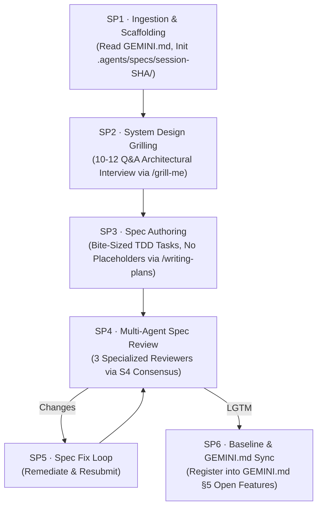

# INVOKE: spec-architect-pipeline (v1.3.4)

## 1. Feature Brief & High-Level Intent
- **Feature Name**: [INSERT KEBAB-CASE NAME, e.g. transaction-history]
- **Short Description**: [INSERT ONE-LINE DESCRIPTION]
- **Target Tech Stack**: [INSERT STACK, e.g. Java Spring Boot + PostgreSQL + Hibernate + Flyway]

## 2. Specification Lifecycle (SP1–SP6)

### Step-by-Step Execution Directives & Mandatory Files to Read

- **SP1 · Ingestion & Scaffolding** (Skill: `skills/spec-architect-pipeline/SKILL.md`):
  - Mandatory Files: `GEMINI.md`, `rules/AGENTS.md`, `skills/spec-architect-pipeline/SKILL.md`.
  - Scaffolding Script: `pwsh -File commands/init-spec-session.ps1 -Name [name]`.
- **SP2 · System Design Grilling (/grill-me)**:
  - Mandatory Rubric: `skills/spec-architect-pipeline/resources/spec-grill-rubric.md` (10–12 architectural interview dimensions).
  - Output Log: `.agents/specs/session-[SHA]/grill/grill-log.md`.
- **SP3 · Spec Authoring (/writing-plans)**:
  - Mandatory Schema: `skills/spec-architect-pipeline/resources/spec-template.md`, `resources/test-driven-development-guide.md`, `resources/error-handling-guide.md`.
  - Target Spec: `.agents/specs/session-[SHA]/YYYY-MM-DD_[name]_SPEC.md`.
- **SP4 · Multi-Agent Spec Review**:
  - Review Guidelines & Templates: `skills/spec-architect-pipeline/resources/spec-review-guide.md`, `resources/submit-template.md`, `resources/review-template.md`.
  - Reviewer Subagents: `agents/spec-system-architect-reviewer.md`, `agents/spec-security-edgecase-reviewer.md`, `agents/spec-testability-scale-reviewer.md`.
- **SP5 · Spec Fix Loop**:
  - Mandatory Findings: `.agents/specs/session-[SHA]/code-review/review/review(n).md`, `skills/spec-architect-pipeline/resources/spec-review-guide.md`, `resources/submit-template.md`.
- **SP6 · Baseline & GEMINI.md Sync**:
  - Automation Command: `pwsh -File commands/sync-spec-gemini.ps1 -Sha [SHA] -Title "[Title]" -Summary "[Summary]"`.
  - Target Document: `GEMINI.md` (§5 Open Features).

## 3. Non-Negotiable Invariants
1. **Mandatory First Action Invariant (Phase Step 0 Read Gate / AP-009)**: On entering ANY phase (SP1–SP6), the orchestrating agent MUST explicitly call `view_file` ONCE on all mandatory phase files for that phase transition BEFORE executing any action tool (`run_command`, `write_to_file`, `replace_file_content`, `invoke_subagent`). Active context is cached in working memory throughout the phase, eliminating turn-by-turn re-reading.
2. **Zero Self-Review Invariant (AP-010)**: The main orchestrating agent is strictly prohibited from authoring `review(n).md` files using `write_to_file` or `replace_file_content`. Multi-agent review in SP4 MUST be delegated to independent subagents (`spec-system-architect-reviewer`, `spec-security-edgecase-reviewer`, `spec-testability-scale-reviewer`) via `invoke_subagent`.
3. Spec remains permanently isolated in `.agents/specs/session-[SHA]/`.
4. Do NOT copy the spec to external folders; link directly from the session directory.
5. Every task in the spec must follow Red-Green-Refactor with exact test commands.
6. Zero placeholders: no "TODO", "TBD", or "add validation".

---
**Directive**: Acknowledge feature brief, initialize `.agents/specs/session-[SHA]/`, and begin SP1.
