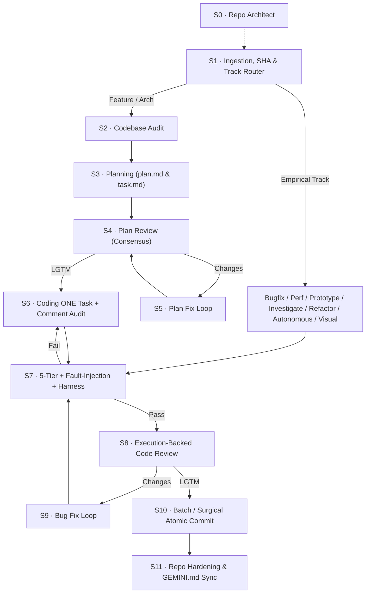

# INVOKE: ideal-agentic-workflow (v2.0.0)

## 1. Operating Mode / Task Track (Select one; defaults cleanly via S1)
- [x] **Standard** — Full S1–S11 lifecycle (`Option A` S3–S4 plan & review gates for features/migrations).
- [ ] **/bugfix** — Live repro & runtime/trace forensics -> minimal evidence-backed fix (`skills/s1-orchestrator/resources/tracks/bugfix-mode.md`).
- [ ] **/perf /hillclimb** — Frozen harness baseline -> single-hypothesis tuning + `skills/benchmark-audit/SKILL.md` (`skills/s1-orchestrator/resources/tracks/perf-hillclimb-mode.md`).
- [ ] **/prototype** — Isolated scratch variants (`skills/s1-orchestrator/resources/tracks/prototype-mode.md`).
- [ ] **/investigate** — Read-only cited explanation (`skills/s1-orchestrator/resources/tracks/investigation-mode.md`).
- [ ] **/refactor** — Contract-pinned structural cleanup (`skills/s1-orchestrator/resources/tracks/refactor-mode.md`).
- [ ] **/autonomous /goal** — Predicate-locked loop with `commands/log-decision.ps1` (`skills/s1-orchestrator/resources/tracks/autonomous-mode.md`).
- [ ] **/visual-parity** — Baseline screenshot-diff visual migration (`skills/s1-orchestrator/resources/tracks/visual-parity.md`).
- [ ] **/fast mode** — Single-task (<= 3 files, 100 LOC), 1 reviewer, audit bypass.
- [ ] **/trivial** — Docs/non-source changes only. Skips audit, review, and tests.
- [ ] **/duolithic mode** — Heavy review offloaded to parallel R-Agent conversation.

## 2. Task Description
<!-- Describe your goal and checkable pass/fail verification criteria here -->
[INSERT TASK DESCRIPTION HERE]

## 3. Skip List (Optional overrides)
- [ ] **S0 — Repo Architect** (Skip if `GEMINI.md` is already certified)
- [ ] **S2 — Codebase Audit** (Skip if `audit.md` exists and is <= 7 days old)
- [ ] **S4 — Plan Review** (Allowed only on fast/empirical single-unit tracks)
- [ ] **S8 — Code Review** (Skip only if mode is `/trivial` or read-only `/investigate`)

*Fill in steps to skip this session:* None

## 4. Execution Lifecycle (S0–S11 & Empirical Tracks)

### Step-by-Step Directives & Mandatory Files

- **S0 · Repo Architect** (`skills/s0-repo-architect/SKILL.md`): `skills/s0-repo-architect/schemas/gemini-prd-schema.json`, `skills/s0-repo-architect/schemas/anti-pattern-schema.json`, `skills/s0-repo-architect/templates/gemini-production-template.md`, `skills/s0-repo-architect/templates/directory-tree-explainer-template.txt`, `resources/gemini-template.md`, `skills/s0-repo-architect/scripts/generate-ascii-tree.js`, `skills/s0-repo-architect/scripts/verify-gemini-schema.js`, `skills/verify-harness-generator/SKILL.md`, `skills/formal-verify-generator/SKILL.md`.
- **S1 · Ingestion & Track Routing** (`skills/s1-orchestrator/SKILL.md`, `skills/workflow-guide/SKILL.md`): `GEMINI.md`, `rules/AGENTS.md`, `resources/engineering-principles.md`, `skills/s1-orchestrator/resources/session-init.md`, `resources/checklist-template.md`, `resources/stacks/_stack-composer.md`, `commands/init-session.ps1`, `skills/s1-orchestrator/resources/fast-mode.md`, `skills/s1-orchestrator/resources/trivial-mode.md`, `skills/s1-orchestrator/resources/duolithic-mode.md`.
- **S2 · Codebase Audit** (`skills/s2-codebase-audit/SKILL.md`): `resources/audit-template.md`, `skills/s2-codebase-audit/resources/audit-compiler.md`, `skills/s2-codebase-audit/resources/fullstack-persona-bank.md`, `skills/s2-codebase-audit/resources/minecraft-persona-bank.md`, `agents/*-auditor.md`, `agents/audit-compiler.md`.
- **S3 / S4 / S5 · Planning & Consensus Review** (`skills/s3-planning/SKILL.md`, `skills/s4-plan-review/SKILL.md`, `skills/s5-plan-fix/SKILL.md`): `resources/plan-template.md`, `resources/task-template.md`, `skills/s3-planning/resources/priority-rubric.md`, `skills/design-architect/SKILL.md`, `skills/solution-arena/SKILL.md`, `skills/blast-radius/SKILL.md`, `agents/arena-cross-judge.md`, `agents/empirical-worker.md`, `agents/plan-critic.md`, `skills/s4-plan-review/resources/plan-review-guide.md`, `resources/submit-template.md`, `resources/review-template.md`.
- **S6 · Coding ONE Task & Hygiene** (`skills/s6-coding/SKILL.md`, `skills/comment-audit/SKILL.md`, `agents/comment-hygiene-reviewer.md`): `resources/senior-dev-standards.md`, `resources/error-handling-guide.md`, `resources/test-driven-development-guide.md`, `skills/s6-coding/resources/stack-detector.md`, `skills/s6-coding/resources/anti-patterns.md`, `resources/stacks/*.md`, `resources/stack-rules/rules-*.md`, `commands/verify-scope.ps1`, `commands/escalate-scope.ps1`, `commands/log-decision.ps1`.
- **S7 · 5-Tier Testing & Formal Check** (`skills/s7-testing/SKILL.md`, `skills/benchmark-audit/SKILL.md`, `skills/statechart/SKILL.md`, `commands/invoke-statechart.ps1`, `commands/verify-stack.ps1`, `commands/check-ui-slop.ps1`): `skills/s7-testing/resources/test-commands.md`, `scripts/check-layout-ast.mjs`, `scripts/check-gesture-parity.mjs`, `scripts/check-route-integrity.mjs`, `scripts/verify-runtime-env.mjs`, `resources/smoke-templates/*`.
- **S8 / S9 · Execution-Backed Code Review & Remediation** (`skills/s8-code-review/SKILL.md`, `skills/adversarial-review/SKILL.md`, `agents/adversarial-falsifier-reviewer.md`, `skills/s9-bug-fix/SKILL.md`): `skills/s8-code-review/resources/task-reviewer-matrix.md`, `skills/s8-code-review/resources/code-review-guide.md`, `agents/fullstack-implementation-reviewer.md`, `agents/*-reviewer.md`.
- **S10 · Batch / Surgical Commit** (`skills/s10-git-commit/SKILL.md`): `commands/auto-commit.ps1` (`scripts/auto-commit.mjs`), `commands/measure-diff.ps1`, `commands/stage-commit.ps1`, `skills/s10-git-commit/resources/commit-examples.md`, `skills/s10-git-commit/resources/breaking-change-guide.md`, `skills/s10-git-commit/resources/commit-split-guide.md`.
- **S11 · Hardening & GEMINI.md Sync** (`skills/s11-gemini-update/SKILL.md`, `skills/repo-hardening/SKILL.md`, `skills/session-reflect/SKILL.md`): `skills/s11-gemini-update/resources/gemini-schema.md`, `resources/gemini-template.md`, `skills/s11-gemini-update/resources/global-skill-suggester.md`, `commands/clean-session.ps1`.

## 5. Non-Negotiable Invariants
1. **Turn-1 & Phase Read Gate (`AP-009`)**: Read `GEMINI.md` + `rules/AGENTS.md` + matching `resources/stack-rules/` BEFORE inspecting source files.
2. **Zero Self-Review (`AP-010`)**: Never write `code-review/review/*` or `audit/bin/*` from the main orchestrator.
3. **Strict Structural Laws**: `1 OOP type per file`, `<= 1` primary component + `<= 2 inline JSX children` per `.tsx`, zero `AP-001..AP-010`.
4. **Proof Over Claims (`EP-01`, `EP-06`, `EP-12`)**: Live repro first, fault-injection test proof, drop unproven review claims, harden repeat errors in code/lints before docs.
5. **No `git push`, No `git add .` (`AP-005`)**: Stage explicitly or run `commands/auto-commit.ps1`; preserve `PascalCase`/`camelCase` identifiers in Conventional Commits (`<= 100` subject / `<= 180` body).

---
**Directive**: Acknowledge mode/track and active stack, initialize `.agents/session-[SHA]/`, and begin S1.
